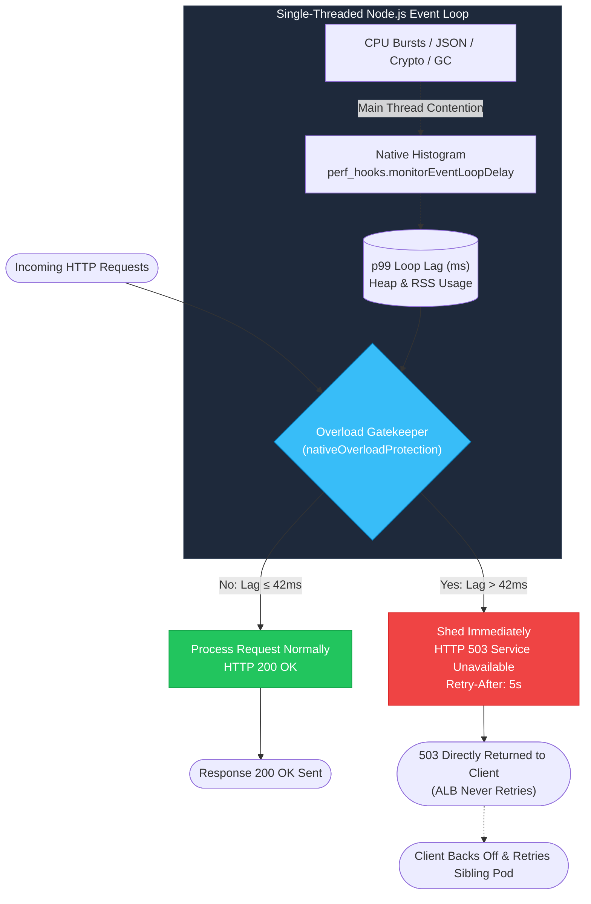
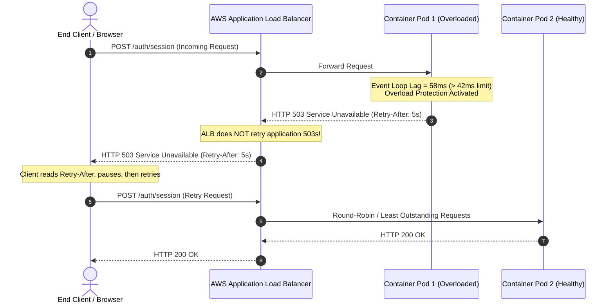

# Architecture & Why Overload Protection Matters

Load shedding and latency guardrails for high-density Node.js microservices and container fleets.

---

## The Core Constraint: Single-Threaded JavaScript

Even with ongoing optimizations in V8 (TurboFan, Maglev) and modern multi-core container nodes, **the foundational constraint of Node.js remains unchanged: JavaScript application code executes on a single main thread**. 

When CPU-intensive tasks, massive JSON parsing, or synchronous schema validations run, the event loop stalls. While the thread is stalled:
1. No other callbacks, network I/O, or timer handlers can execute.
2. Incoming TCP connections queue up in socket backlogs.
3. Memory consumption grows as unprocessed request bodies accumulate.
4. Latency degrades exponentially rather than linearly.



---

## 4 Key Reasons Overload Protection is Vital

### 1. Container CPU Quotas & Linux CFS Throttling
Modern cloud platforms (Kubernetes, AWS ECS/Fargate, Google Cloud Run) enforce strict container CPU limits via Linux Completely Fair Scheduler (CFS) bandwidth control (e.g. `limits.cpu: 500m` or `1000m`). When a container exceeds its millicore quota within a 100ms accounting window, **the Linux kernel suspends the container process completely** until the next period.
- To the Node.js runtime, CFS throttling appears as sudden, massive spikes in event loop delay.
- Without overload protection, queued incoming requests flood memory. When the process unpauses, it attempts to process hundreds of stale requests at once, precipitating out-of-memory crashes (`OOMKilled`) or Kubernetes liveness probe timeouts (`CrashLoopBackOff`).
- With `overload-protection`, subsequent requests receive immediate `503` responses, shielding the container and allowing it to catch up.

### 2. Modern Workloads: AI Agent Pipelines, Streaming & Schema Validation
Modern Node.js backends frequently act as gateways for LLM agents, vector databases, and high-throughput microservices:
- **Massive JSON & Token Parsing**: Deserializing multi-megabyte structured tool outputs or streaming token batches.
- **Runtime Schema Validation**: Complex validation engines (Zod, TypeBox, Ajv) running recursive checks over large inputs.
- **Cryptographic Operations**: Session creation, JWT signing, and password hashing (each blocking the loop for 16ms+).

A burst of compound cryptographic operations or schema validations blocks the thread for tens or hundreds of milliseconds. Shedding non-critical traffic during these bursts keeps the process healthy.

### 3. Little's Law & The Non-Linear Queue Cliff
Queueing theory dictates that average queue depth is a function of arrival rate and service time ($L = \lambda W$):

$$\text{Capacity} = \frac{1}{\text{Average Processing Time per Request}}$$

As server utilization ($\rho$) approaches 85–90%, queue depth and latency do not increase proportionally—**they explode exponentially**:

```
Latency ^
        |                                        / (Catastrophic Queue Collapse)
        |                                      /
        |                                    /
        |                             ____ /
        +----------------------------/------------------> Saturation (%)
        0%                          80%   90%  100%
```

When a Node.js server attempts to process 100% of incoming requests under saturation, **all requests suffer degraded latency and eventually time out**. By shedding a small fraction of traffic with `503`, the server keeps its event loop healthy and processes the remaining requests with sub-10ms latency.

### 4. Microservice Retry Storms & Fail-Fast Protection
In distributed microservices, when a downstream Node.js service becomes unresponsive, upstream clients begin timing out and initiating retries. This creates a vicious **retry storm** that rapidly exhausts connection pools.

Rejecting requests immediately at the process boundary with `503` and a `Retry-After: 5` header signals clients to fail fast and back off, preventing systemic cascade failure.

---

## Load Balancer (ALB) & Fleet Ingress Dynamics

A common misconception is that cloud load balancers (such as AWS Application Load Balancers) retry failed requests or "rescue" them if a container returns 503.



### Key Principles of Cloud Ingress Load Shedding:
1. **ALB Does NOT Retry 503 Responses**:
   The Application Load Balancer immediately forwards the 503 straight to the client.
2. **Deterministic Response Time (<1ms)**:
   Instead of hanging for 30 seconds waiting for ALB socket timeout (`504 Gateway Timeout`), the client receives an instantaneous `503` with structured JSON error details.
3. **Queue Collapse Defense**:
   If an unprotected Node.js server enters queue collapse, callbacks take longer than 30s to emit. While the ALB returns 503 to the client after its 30s timeout, **the unprotected Node.js task will still carry on doing the work to completion**, wasting precious CPU cycles on dead requests.
4. **Client Backoff**:
   The `Retry-After: 5` header instructs the client to wait 5 seconds before retrying, giving autoscalers time to spin up new replicas.

---

## Interactive Simulation

To see these principles visualized in real time across a 6-container Node.js cluster:
👉 **[Open `demos/visualization.html`](../demos/visualization.html)**

It simulates:
- Real-time rotating event loop wheels synchronized to container loop lag.
- The 4 Golden Signals (Traffic, Latency p95/p99, Error Rate, Saturation).
- Little's Law live capacity planning (1 heavy crypto request + 8 lite transactions per user journey).
- Automated $\pm 50\%$/min autoscaler lag scenarios.
