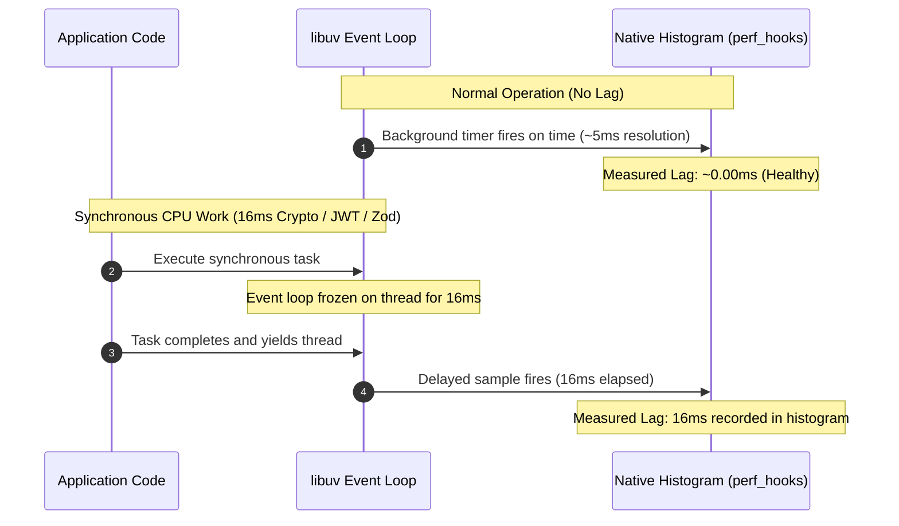

# Event Loop Delay Detection & Internals

Deep dive into how `overload-protection` measures event loop lag, memory pressure, and thread contention.

---

## How Event Loop Delay Detection Works

In Node.js, asynchronous I/O and scheduled timers are orchestrated by `libuv` on a single execution thread. When JavaScript executes synchronous (blocking) work, `libuv` cannot advance to subsequent phases:



---

## Native `node:perf_hooks` Engine

In modern Node.js, `perf_hooks.monitorEventLoopDelay` provides native C++ event loop sampling:

```javascript
import { monitorEventLoopDelay } from 'node:perf_hooks'

// Replaces manual setInterval polling loops
const eventLoopMonitor = monitorEventLoopDelay({ resolution: 5 })
eventLoopMonitor.enable()
```

### Why `monitorEventLoopDelay` is Superior
1. **Zero Polling Overhead**:
   Unlike legacy JavaScript timers that wake the event loop and contend with application code, `monitorEventLoopDelay` is implemented in C++ using high-resolution monotonic clocks.
2. **Nanosecond Precision**:
   Delays are recorded in high-resolution nanosecond buckets. Converting to milliseconds is as simple as dividing by $10^6$ (`/ 1e6`).
3. **Statistical Robustness (p99)**:
   By tracking percentiles (`eventLoopMonitor.percentile(99)`), transient single-tick anomalies are smoothed out while genuine sustained overload is caught instantly.

### Why p99 (`percentile(99) / 1e6`) is the Gold Standard
- **Median (p50)** is too slow to react; by the time p50 breaches 42ms, the process has already accumulated thousands of queued requests.
- **Max** is too sensitive to one-off GC pauses that may resolve within a single frame.
- **p99** catches the leading edge of queue degradation precisely when the server begins struggling, allowing load shedding to kick in before memory bloat occurs.

---

## Memory Metrics: Heap vs RSS

In addition to event loop delay, `overload-protection` can monitor memory consumption:

```
+--------------------------------------------------------------+
| Process Resident Set Size (RSS)                              |
| +----------------------------------------------------------+ |
| | V8 Total Heap Size                                       | |
| | +-----------------------+ +----------------------------+ | |
| | | V8 Used Heap Size     | | V8 Unallocated Heap Space  | | |
| | | (Active JS Objects)   | |                            | | |
| | +-----------------------+ +----------------------------+ | |
| +----------------------------------------------------------+ |
| +----------------------------------------------------------+ |
| | Native Buffers, C++ Bindings, libuv Thread Pool Memory   | |
| +----------------------------------------------------------+ |
+--------------------------------------------------------------+
```

### 1. `maxHeapUsedBytes` (V8 Used Heap)
- Measures the active memory occupied by JavaScript objects, closures, and strings (`process.memoryUsage().heapUsed`).
- Indicates when JavaScript application state or caching structures are nearing the V8 maximum heap allocation (e.g. `--max-old-space-size`).

### 2. `maxRssBytes` (Resident Set Size)
- Measures total physical RAM allocated to the process by the OS, including the V8 heap, native C++ memory, Buffer allocations, and memory-mapped files (`process.memoryUsage.rss()`).
- Essential in Kubernetes and container environments to prevent hard container terminations by the Linux Out-Of-Memory (`OOMKilled`) killer.

---

## Profiler State & Prototype Inheritance

When using the multi-framework adapter:
```javascript
const protect = require('overload-protection')('express', opts)
```

The returned middleware inherits from the underlying profiler prototype:

| Property | Type | Description |
| :--- | :--- | :--- |
| `instance.overload` | `boolean` | `true` if any configured threshold is currently breached |
| `instance.eventLoopOverload` | `boolean` | `true` if event loop lag exceeds `maxEventLoopDelayMs` |
| `instance.heapUsedOverload` | `boolean` | `true` if heap used exceeds `maxHeapUsedBytes` |
| `instance.rssOverload` | `boolean` | `true` if RSS exceeds `maxRssBytes` |
| `instance.eventLoopDelay` | `number` | Live detected lag in milliseconds |
| `instance.eventLoopMonitor` | `object` | Native `IntervalHistogram` instance |
| `instance.stop()` | `function` | Disables monitoring and clears all internal timers |
