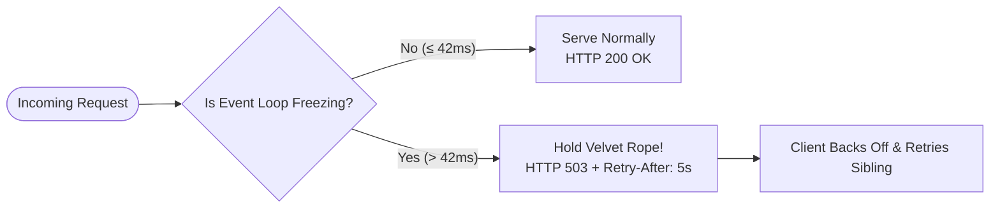
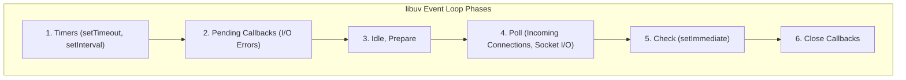

# Presentation: Overload Protection Explained

An interactive, visual walkthrough explaining the single-threaded Node.js event loop, how queue collapse manifests, and how native load shedding protects container fleets.

> 📽️ **Interactive Slide Deck Available**:
> You can present or click through the interactive slide deck directly in your browser:
> 👉 **[Launch Interactive Slide Deck (Fullscreen)](https://andylockran.github.io/overload-protection/demos/presentation.html)** · **[Live 6-Pod Fleet Simulation](https://andylockran.github.io/overload-protection/demos/visualization.html)**

---

## Slide 1: Executive Overview

**Title**: Node.js Fleet Overload Protection  
**Subtitle**: From Event Loop Freezes to Native 2026 Circuit Breaking

### Key Themes:
1. **The Core Problem**: JavaScript is single-threaded. When synchronous tasks or CPU bursts stall the thread, queues explode exponentially.
2. **Cloud Reality**: AWS Application Load Balancers (ALBs) never retry application 503s. Unprotected nodes stay frozen executing dead requests while memory balloons.
3. **The Native Solution**: Using Node's native `perf_hooks.monitorEventLoopDelay` to shed load at p99 in <1ms with `Retry-After: 5s`.

---

## Slide 2: In Simplest Terms — What Does This Library Do?

Think of your Node.js container like a packed nightclub with a single bartender and a velvet rope at the door.



### The Scenario:
- **Without Overload Protection**:
  The bartender is pouring a complicated 30-step cocktail (a 16ms synchronous crypto hash). Meanwhile, 200 people push into the hallway. The room runs out of air, everyone waits 30 seconds, and the fire marshal shuts down the entire building (`OOMKilled` or liveness probe failure).
- **With Overload Protection**:
  The bouncer at the door checks the bartender. The bartender is lagging! The bouncer instantly tells new arrivals: *"We're full right now! Please wait 5 seconds before trying again (HTTP 503 + `Retry-After: 5s`)"*. Existing patrons finish their drinks, and the venue stays open and profitable!

---

## Slide 3: The Engine Room — The Node.js Event Loop

Node.js achieves massive scalability by offloading I/O to operating system kernels and handling callbacks sequentially on one thread.



### The Golden Rule of Node.js:
As long as callbacks return quickly (< 1ms), the event loop completes full rotations in ~2ms, effortlessly serving thousands of requests per second. **Problems only begin when synchronous code blocks the thread.**

---

## Slide 4: How the Problem Manifests — The Synchronous Freeze & Queue Cliff

When heavy synchronous tasks execute, latency doesn't degrade linearly—it explodes exponentially.

### Modern Synchronous Blockers:
- **Cryptographic Sessions**: JWT verification, session token hashing (~16ms/op).
- **Large JSON Parsing**: Multi-megabyte LLM tool outputs (30–60ms).
- **Schema Validation**: Deep recursive Zod / TypeBox validation runs.
- **Linux CFS Throttling**: Kernel pauses containers exceeding CPU quotas.

### Little's Law (L = λ · W) & The Non-Linear Queue Cliff:
```
Latency ^
        |                                        / (Catastrophic Queue Collapse)
        |                                      /
        |                                    /
        |                             ____ /
        +----------------------------/------------------> Saturation (%)
        0%                          80%   90%  100%
```

If a node takes 30s to respond, **the cloud load balancer (ALB) gives up and sends 503 to the client, but the Node.js server still keeps executing the dead work to completion!**

---

## Slide 5: How the Original Library Solved It (2017)

Back in Node.js v6/v8, there was no native API to measure event loop delay. David Mark Clements pioneered an ingenious timer-drift heuristic.

```javascript
let last = process.hrtime.bigint()

function check () {
  const now = process.hrtime.bigint()
  const deltaMs = Number(now - last) / 1e6
  const delay = Math.max(0, deltaMs - 5)
  if (delay > 42) {
    profiler.overload = true
  }
  last = now
}
setInterval(check, 5).unref()
```

### Historical Limitations:
1. **Active JS Overhead**: Running a JS timer every 5ms constantly woke up the event loop.
2. **Coarse Resolution**: Single-sample snapshots missed brief mid-interval spikes.
3. **Plaintext Responses**: Only supported basic strings without structured JSON error payloads.

---

## Slide 6: How the Modern Solution Simplifies It (2026)

Node.js core now provides native C++ histogram tracking via `perf_hooks.monitorEventLoopDelay`.

### Zero-Overhead C++ Engine:
```javascript
import { monitorEventLoopDelay } from 'node:perf_hooks'

const monitor = monitorEventLoopDelay({ resolution: 5 })
monitor.enable()

// Instant O(1) p99 percentile query:
const currentLagMs = monitor.percentile(99) / 1e6
```

### 3-Line Express Integration:
```javascript
import express from 'express'
import { nativeOverloadProtection } from '@andylockran/overload-protection'

const app = express()
app.use(nativeOverloadProtection) // 42ms limit, Retry-After: 5s
```

---

## Slide 7: Evolution Summary

| Metric / Capability | Legacy 2017 Library | Modern 2026 Native Solution |
| :--- | :--- | :--- |
| **Measurement Engine** | Manual `setInterval` + `process.hrtime` | Native C++ `perf_hooks.monitorEventLoopDelay` |
| **Overhead** | Continuous JS timer polling | Zero JS wakeups (native histogram) |
| **Statistical Precision** | Single delta snapshot | p99 percentile over thousands of ticks |
| **Response Payload** | Plain text string | Structured JSON (`{ error, message, lagMs }`) |
| **Setup Code** | Multi-step factory + prototype setup | Direct 1-line middleware mounting |

---

## Interactive Demos

- 📽️ **[Launch Interactive Presentation Deck](https://andylockran.github.io/overload-protection/demos/presentation.html)**
- 🎮 **[Launch 6-Pod Fleet Simulation](https://andylockran.github.io/overload-protection/demos/visualization.html)**
