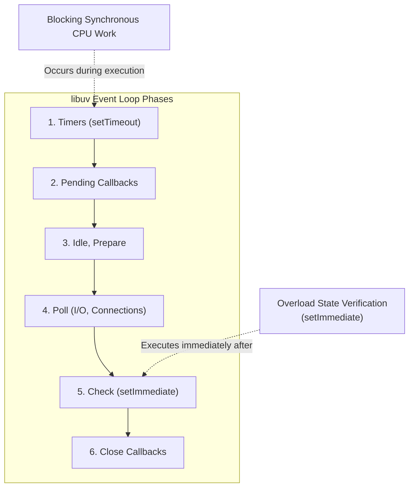

# Testing, Benchmarks & Timing Strategy

Overview of the testing architecture, Vitest integration, CPU load evolution, and performance benchmarking.

---

## Test Suite Architecture

The test suite runs under **Vitest** with V8 native coverage instrumentation:

```bash
# Run full test suite (82 passing tests)
npm test

# Run test suite with V8 code coverage report
npm run cov

# Generate HTML and JSON test reports
npm run test:report
```

### Test Organization

```
test/
├── index.js                     # Core unit tests (validation, metrics, lifecycle, prototype chain)
└── integration/
    ├── native/index.js          # Native middleware integration (JSON responses, Retry-After, headers)
    ├── express/index.js         # Express framework integration tests
    ├── http/index.js            # Node.js core http integration tests
    └── koa/index.js             # Koa framework integration tests
```

---

## Timing Strategy: Why `setImmediate`?

Testing event loop delay requires deliberate coordination with Node.js libuv phase ordering:



1. **Synchronous CPU Work**:
   When a test executes a tight busy-loop to simulate thread contention, all libuv phases are paused.
2. **Next Tick Yield**:
   Once the busy-loop finishes, queued timers execute.
3. **Verification in `setImmediate`**:
   `setImmediate` fires in the **Check** phase, guaranteeing that timers and native histograms have recorded the delay *before* assertions execute.

---

## Evolution of Test CPU Load (2015 vs Modern V8)

### The JIT Optimization Challenge
In early Node.js versions (v0.12–v6), a simple arithmetic loop (`while (Date.now() - start < 100) {}`) reliably blocked the thread.

In modern V8 engines (TurboFan, Maglev):
- Simple loops without memory writes or side effects are recognized as dead code and hoisted or aggressively optimized.
- Modern high-core CPUs can execute simple iterations in nanoseconds.

### The Modern Test Solution
To reliably stall the thread in testing across all environments (including busy CI runners), the test suite uses nested bitwise hashing and variable array allocations that prevent the compiler from optimizing the work away:

```javascript
while (Date.now() - start <= busyMs) {
  let hash = 0
  for (let i = 0; i < 100000; i++) {
    for (let j = 0; j < 10; j++) {
      hash = ((hash << 5) - hash) + i * j
      hash = hash & hash
    }
  }
}
```

---

## Benchmarks

`overload-protection` is designed for ultra-low latency critical paths. To measure comparative overhead:

```bash
npm run benchmarks
```

It profiles overhead across:
1. Pure HTTP core vs with `overload-protection`
2. Express core vs with `nativeOverloadProtection`
3. Koa core vs with `overload-protection`

The overhead of checking `eventLoopMonitor.percentile(99)` is sub-microsecond (< 0.001 ms), adding virtually zero latency to accepted requests.
