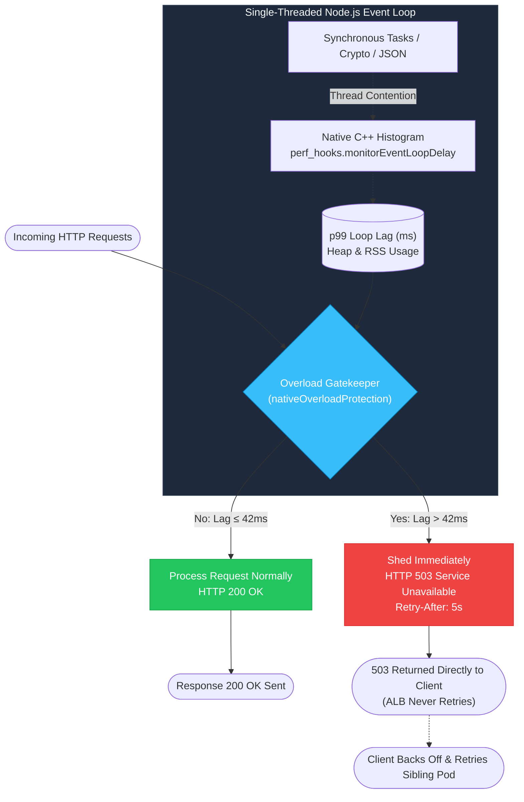

# overload-protection

High-performance load detection and automated shedding for Node.js microservices and container fleets (`express`, `http`, `koa`, and native middleware).

[](https://travis-ci.org/davidmarkclements/overload-protection)
[](https://coveralls.io/github/davidmarkclements/overload-protection)
[](https://standardjs.com)

> 🚀 **Interactive Tools**:  
> 📽️ **[Interactive Presentation Deck](demos/presentation.html)** · 🎮 **[Live 6-Pod Fleet Simulation](demos/visualization.html)** · 📖 **[Architecture Deep-Dive](docs/architecture-and-why-it-matters.md)**

---

## Overview

When a single-threaded Node.js server experiences heavy traffic or synchronous CPU bursts (such as cryptographic session creation, JWT signing, or schema validation), the event loop lags. As saturation approaches 90%, queue depth and latency explode non-linearly.

`overload-protection` acts as an automated circuit breaker at the process boundary. When p99 event loop lag or memory exceeds your configured threshold, incoming requests are shed immediately with **HTTP 503 Service Unavailable** and a **`Retry-After: 5s`** header, returning straight to the client with sub-millisecond response times. This protects your container from queue collapse, memory exhaustion, and Kubernetes `CrashLoopBackOff`.



---

## Quickstart

### 1. Native Express Middleware (Recommended)

Powered by Node's built-in `node:perf_hooks.monitorEventLoopDelay({ resolution: 5 })` with zero polling loop overhead:

```javascript
import express from 'express'
import { nativeOverloadProtection } from '@andylockran/overload-protection'

const app = express()

// Zero-config: uses defaults (42ms limit, Retry-After: 5s, 503 JSON)
app.use(nativeOverloadProtection)

// Or with custom options:
app.use(nativeOverloadProtection({
  production: process.env.NODE_ENV === 'production',
  clientRetrySecs: 5,        // Tell clients to wait 5 seconds before retrying
  maxEventLoopDelayMs: 42,   // Maximum p99 loop lag threshold in ms
  errorPropagationMode: false // false = return 503 JSON immediately, true = next(err)
}))
```

When overloaded (`currentLagMs > maxEventLoopDelayMs`), it immediately responds with:
```json
{
  "error": "Service Unavailable",
  "message": "Server is currently overloaded, please try again later.",
  "lagMs": "54.12"
}
```
*(Diagnostic `lagMs` is automatically omitted when `production: true`)*.

---

### 2. Multi-Framework Adapter (`express`, `http`, `koa`)

You can also use the unified adapter across multiple Node.js web frameworks:

```javascript
import protect from '@andylockran/overload-protection'

const config = {
  production: process.env.NODE_ENV === 'production',
  clientRetrySecs: 5,
  maxEventLoopDelayMs: 42,
  sampleInterval: 5
}

// Express
app.use(protect('express', config))

// Koa
app.use(protect('koa', config))

// Core Node.js HTTP
const guard = protect('http', config)
http.createServer((req, res) => {
  if (guard(req, res)) return // Returns true if 503 was sent
  res.end('Hello world')
})
```

---

## Interactive Visualization

An interactive visual simulation of a **6-container Node.js cluster** running under a cloud load balancer is included in this repository:

👉 **[Open `demos/visualization.html`](demos/visualization.html)** directly in your browser or run locally:

```bash
npx serve .
# Open http://localhost:3000/demos/visualization.html
```

### What the Simulation Demonstrates
- **Physical Event Loop Animation**: 6 animated rotating wheels dynamically synchronized to container loop lag ($5.2^\circ/\text{frame}$ when healthy, slowing to $2.8^\circ$ during crypto, and churning at $0.9^\circ$ during queue collapse without stopping).
- **The 4 Golden Signals**: Real-time fleet telemetry tracking Traffic (baseline 60 req/min up to 500,000 req/min), Latency (p95 & p99), Error Rate, and Saturation.
- **Little's Law Live Capacity Planner**: Calculates exact container capacity needed for discreet user journeys (1 heavy cryptographic session creation + 8 lite transactions).
- **Automated $\pm 50\%$/min Surge**: Simulates autoscaler provisioning lag and demonstrates how shedding prevents queue collapse.
- **Cloud Ingress Behavior**: Confirms that cloud ALBs return 503 straight to the client without retrying, allowing clients to back off safely.

---

## Documentation Hub

Explore the deep-dive guides for full architectural, operational, and API details:

| Document | Topics Covered |
| :--- | :--- |
| 📽️ **[Interactive Presentation & Slides](docs/presentation.md)** | Step-by-step presentation: nightclub bouncer intuition, event loop internals, problem manifestation, 2017 hack, and 2026 native simplification. |
| 📖 **[Architecture & Why Overload Protection Matters](docs/architecture-and-why-it-matters.md)** | Modern 2026 container challenges, Linux CFS throttling, Little's Law queue cliffs, microservice retry storms, ALB ingress behavior. |
| ⚙️ **[Event Loop Delay Detection & Internals](docs/event-loop-detection-and-internals.md)** | `node:perf_hooks` native C++ histogram engine, p99 nanosecond calculations, V8 Used Heap vs Resident Set Size (RSS). |
| 📚 **[Full API & Configuration Reference](docs/api-reference.md)** | Complete options reference, `nativeOverloadProtection`, `protect(framework)`, error propagation mode, JSON response schema, and lifecycle management. |
| 📊 **[Testing, Benchmarks & Timing Strategy](docs/testing-and-benchmarks.md)** | Vitest test suite architecture (82 passing tests), `setImmediate` timing strategy, V8 JIT CPU load evolution, and benchmark results. |

---

## Configuration Reference

| Option | Type | Default | Description |
| :--- | :--- | :--- | :--- |
| `production` | `boolean` | `process.env.NODE_ENV === 'production'` | Suppresses internal diagnostics (`lagMs`) in client error payloads. |
| `clientRetrySecs` | `number` | `5` | `Retry-After` header value in seconds (`0` disables the header). |
| `maxEventLoopDelayMs` | `number` | `42` | Max acceptable p99 event loop delay in ms (`0` disables loop lag check). |
| `maxEventLoopDelay` | `number` | `42` | Backward-compatible alias for `maxEventLoopDelayMs`. |
| `resolution` | `number` | `5` | Resolution (in ms) for the native `monitorEventLoopDelay` histogram. |
| `sampleInterval` | `number` | `5` | Backward-compatible alias for `resolution`. |
| `maxHeapUsedBytes` | `number` | `0` (disabled) | V8 heap used threshold in bytes (`process.memoryUsage().heapUsed`). |
| `maxRssBytes` | `number` | `0` (disabled) | Resident Set Size threshold in bytes (`process.memoryUsage().rss()`). |
| `errorPropagationMode` | `boolean` | `false` | If `true`, passes `err` with `err.status = 503` to `next(err)` instead of responding directly. |
| `json` | `boolean` | `false` | Explicitly enables JSON responses (defaults `true` for `nativeOverloadProtection`). |
| `logging` | `string \| function` | `false` | Log level string for request logger (e.g. `'warn'`) or custom callback. |
| `logStatsOnReq` | `boolean` | `false` | Logs full telemetry stats on every request (requires `logging`). |

---

## Installation

### Official Package
```bash
npm install overload-protection
```

### GitHub Packages (This Fork)
```bash
npm install @andylockran/overload-protection --registry=https://npm.pkg.github.com
```

---

## Testing

```bash
# Run Vitest test suite (82 tests across 5 test suites)
npm test

# Run tests with V8 code coverage report (>94% coverage)
npm run cov

# Verify JavaScript Standard Style
npm run lint

# Run comparative framework benchmarks
npm run benchmarks
```

---

## License

MIT © [David Mark Clements](https://github.com/davidmarkclements), [Andy Loughran](https://github.com/andylockran).
